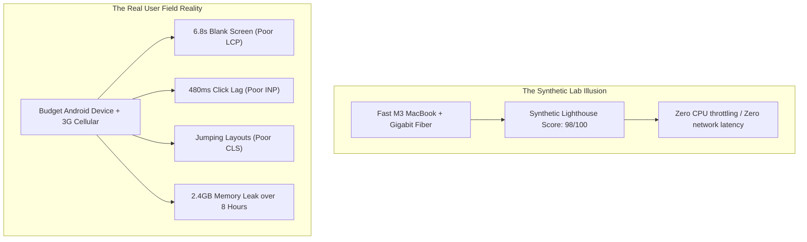
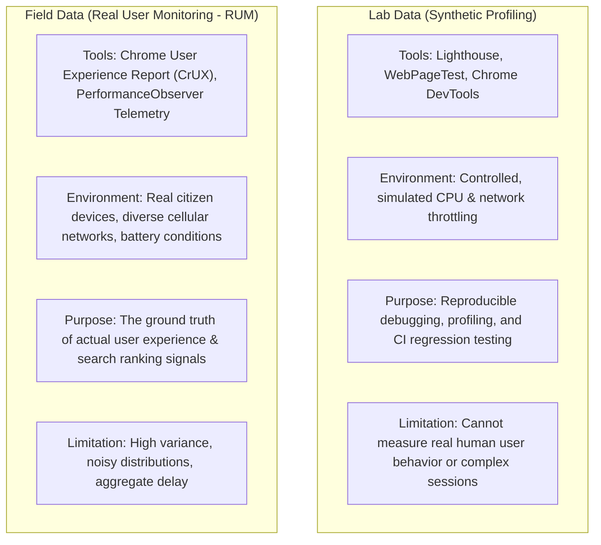
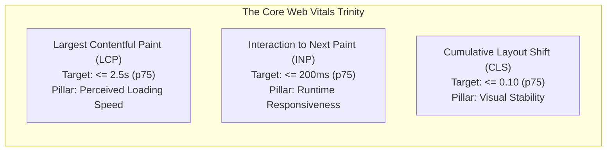
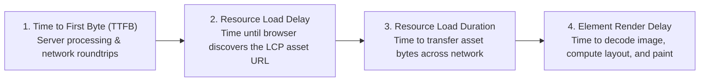
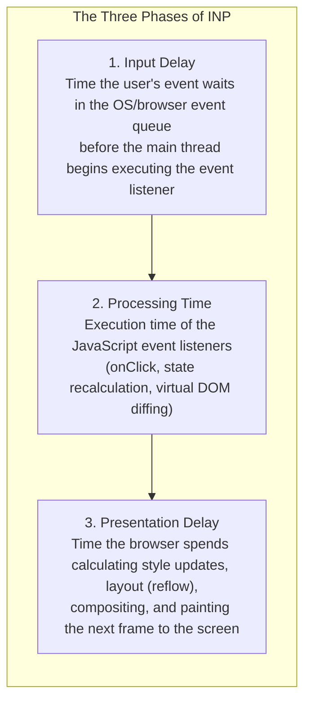
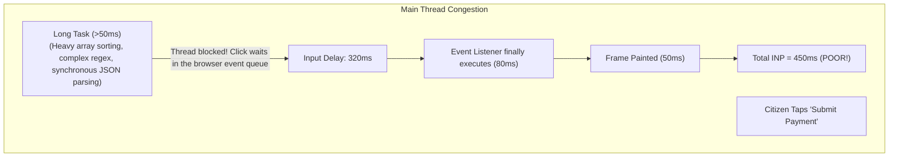
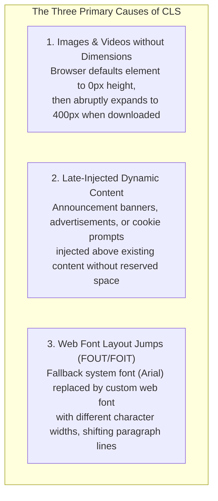
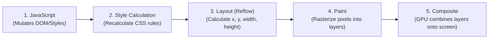
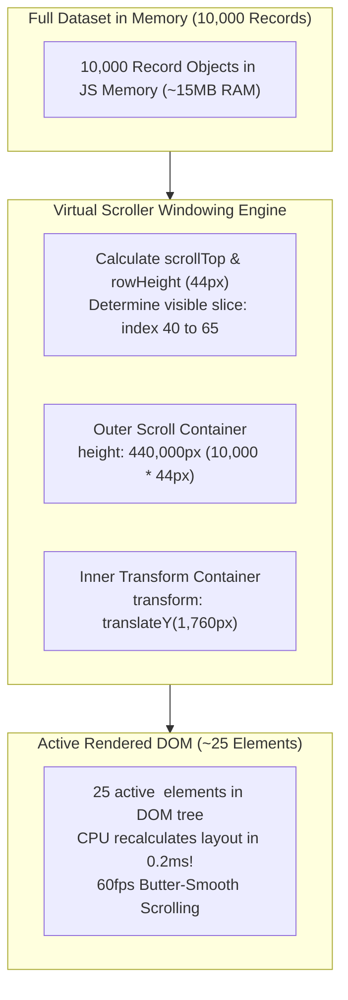

The Erbil Municipal Technology Directorate deploys its newly redesigned public E-Services portal. In the headquarters conference room, the development team tests the portal on top-tier developer laptops connected to gigabit municipal fiber. The synthetic Lighthouse audit flashes a near-perfect score: **98/100**. The team declares victory and goes home for the weekend.

On Monday morning, telemetry alerts and citizen complaint tickets flood the municipal helpdesk:
- In the mountain districts of Soran and Shaqlawa, citizens accessing the portal on entry-level Android smartphones over congested 3G cellular networks wait **6.8 seconds** staring at a completely blank white screen before the hero image of the municipal citadel renders.
- When an applicant attempts to click "Pay Permit Fee," the button does not respond for **480 milliseconds** because a heavy analytics bundle is executing a 350ms Long Task on the browser's single main thread. Believing their click was ignored, citizens tap the button repeatedly, triggering duplicate payment requests.
- Just as a citizen positions their thumb to tap "Cancel Application," a delayed municipal emergency notification banner injects at the top of the viewport. The entire page abruptly shifts downward by 80 pixels; the citizen's thumb accidentally taps "Submit Non-Refundable Application" instead.
- In municipal licensing offices, civil servants who leave the administrative dashboard open on their desks all day report that by 3:00 PM, their browser tabs consume **2.4 gigabytes of memory**, laptop cooling fans spin at maximum velocity, and typing in form inputs lags by half a second per keystroke.

Every one of these failures stems from the same dangerous engineering illusion: **evaluating performance through synthetic lab scores on powerful developer machines rather than measuring real human experience under field conditions**.



Performance is not a single vanity score. Performance is the study of how quickly, smoothly, and reliably users can see content, interact with controls, and complete their digital journeys.

In this chapter, we bridge high-level performance metrics with low-level browser mechanics. We deconstruct Google's **Core Web Vitals** - Largest Contentful Paint (LCP), Interaction to Next Paint (INP), and Cumulative Layout Shift (CLS); analyze the browser's rendering engine and layout thrashing; tame long main-thread tasks; implement DOM virtualization; and establish continuous real-user monitoring (RUM) pipelines.

---

## 1. The Reality of Web Performance: Field vs. Lab and the 75th Percentile

Front-end engineering evaluates performance across two distinct measurement methodologies:



### The 75th Percentile (p75) Standard
Never evaluate front-end performance using arithmetic averages. Performance data is heavily right-skewed: most visits are fast, and a long tail is very slow. If twenty citizens visit the portal:
- Fourteen citizens on fiber connections experience a fast 1.0s load.
- Six citizens on congested rural 3G connections experience a 6.0s load.
- The arithmetic average is $2.5\text{s}$, which looks like it exactly meets the "Good" LCP threshold.
- The 75th percentile is $6.0\text{s}$: the slowest quarter of visits is clearly in the "Poor" range, and the average hid it.

Averages are also distorted by single extreme outliers (one 60s timeout can double a mean), so they describe neither the typical visit nor the slow ones.

Google's Core Web Vitals program evaluates the **75th Percentile (p75)**: a page passes when at least 75% of real page visits meet the "Good" threshold. p75 is a deliberate compromise - high enough to include users on slower devices and networks, yet stable enough not to be dominated by a handful of outliers. It is still a single number, so teams should also:
- **Segment** p75 by device class, connection type, country/region, and route, because a global p75 can improve while an important segment regresses.
- **Watch the tail** (p95/p99) for critical journeys such as payments, where even 5% of citizens failing is unacceptable.

---

## 2. The Core Web Vitals Trinity

Google's **Core Web Vitals** are three user-centric performance metrics that measure the primary pillars of the web user experience:



Each metric has three bands, assessed at p75 of real visits:

| Metric | Good | Needs Improvement | Poor |
|---|---|---|---|
| LCP | $\le 2.5\text{s}$ | $2.5\text{s} - 4.0\text{s}$ | $> 4.0\text{s}$ |
| INP | $\le 200\text{ms}$ | $200\text{ms} - 500\text{ms}$ | $> 500\text{ms}$ |
| CLS | $\le 0.1$ | $0.1 - 0.25$ | $> 0.25$ |

---

## 3. Largest Contentful Paint (LCP): Anatomy of Loading

**Largest Contentful Paint (LCP)** measures perceived loading speed. It marks the point on the page load timeline when the primary content element in the viewport - typically a large hero image, a video poster frame, or a large block of heading typography - has rendered on screen.

### The Four Sub-Parts of LCP

To diagnose an LCP problem, architects dissect the metric into its four constituent sub-parts:



$$\text{LCP} = \text{TTFB} + \text{Resource Load Delay} + \text{Resource Load Duration} + \text{Element Render Delay}$$

### The LCP Request Waterfall Anti-Pattern

In poorly architected Single-Page Applications, LCP candidate images are discovered through an asynchronous waterfall:

```mermaid
sequenceDiagram
    autonumber
    actor Browser
    participant CDN as Static Host
    participant API as Backend API

    Browser->>CDN: GET /permits/104 (Downloads HTML Shell)
    Note over Browser: Browser parses HTML shell; discovers script tag
    Browser->>CDN: GET /assets/app.js (1.2 MB Bundle)
    Note over Browser: Browser parses & compiles JS (takes 250ms)
    Browser->>API: GET /api/permits/104 (Fetches record JSON)
    API-->>Browser: Returns JSON with heroImageUrl: "/img/citadel.png"
    Note over Browser: Browser FINALLY discovers LCP image URL at t = 3.8s!
    Browser->>CDN: GET /img/citadel.png (Uncompressed 3.5MB PNG)
    Note over Browser: LCP Element Paints at t = 6.2s (POOR!)
```

### Engineering Remedies for LCP:
1. **Make the LCP Image Discoverable in the HTML:** The best fix for Resource Load Delay is to render the hero `` in the server-sent HTML (SSR/SSG) so the browser's preload scanner finds it immediately. When the URL can only be known late (e.g. it lives in CSS or is injected by JavaScript), declare it in the static HTML `<head>` with a preload. For responsive images, use `imagesrcset`/`imagesizes` so the preload fetches the same file the `` will choose:
   ```html
   <link rel="preload" as="image" fetchpriority="high"
         imagesrcset="/img/citadel-480.avif 480w, /img/citadel-960.avif 960w, /img/citadel-1600.avif 1600w"
         imagesizes="100vw" type="image/avif">
   ```
2. **Prioritize with `fetchpriority="high"`:** Images start at low priority until the browser knows they are in the viewport. `fetchpriority="high"` on the LCP `` (or its preload) is a priority hint that lets the hero image compete with render-blocking resources instead of waiting behind them. Use it on one or two images only - if everything is high priority, nothing is.
3. **Never Lazy-Load the LCP Image:** `loading="lazy"` delays the request until layout confirms the image is in the viewport. Lazy-load below-the-fold images, but load the hero eagerly.
4. **Modern Compressed Formats:** Replace legacy JPEGs and PNGs with **AVIF** and **WebP**. Compared with a well-optimized JPEG, they commonly save around 25% to 50% of the bytes at similar visual quality (savings against an uncompressed PNG photo are far larger). Measure on your own images rather than trusting a fixed percentage.
5. **Responsive Sizing (`srcset` + `sizes`):** Serve a ~480px image to small mobile screens rather than forcing a smartphone to download a 2400px desktop banner, and use `<picture>` to fall back to older formats:
   ```html
   <picture>
     <source type="image/avif"
             srcset="/img/citadel-480.avif 480w, /img/citadel-960.avif 960w, /img/citadel-1600.avif 1600w"
             sizes="100vw">
     
   </picture>
   ```
6. **Reduce TTFB:** Cache HTML at the CDN edge where possible, and avoid chains of redirects before the document arrives. No front-end optimization can paint content before the first byte arrives.

---

## 4. Interaction to Next Paint (INP): The Responsiveness Standard

In March 2024, **Interaction to Next Paint (INP)** officially replaced the legacy First Input Delay (FID) as a Core Web Vital.

* **Why FID was Inadequate:** FID only measured the *input delay* of the *first* click on a page. If an application responded quickly to the first click but froze for half a second on every subsequent tab switch, form submission, or search keystroke, FID scored a deceptive 100%.
* **What INP Measures:** INP assesses the responsiveness of **all user interactions** (mouse clicks, taps, keypresses) throughout the entire lifetime of the user's visit, and measures the full time until the next frame is painted, not only the input delay. Scrolling and hovering are not counted. For most pages the INP value is simply the **slowest interaction** of the visit; on pages with many interactions, the browser ignores one highest interaction for every 50 interactions, so a single random hiccup in a long session does not define the score.

### The Anatomy of an Interaction

When a citizen clicks a button, the total interaction latency consists of three distinct phases:



$$\text{INP} = \text{Input Delay} + \text{Processing Time} + \text{Presentation Delay}$$

### The Single Main Thread & Long Tasks

Browsers execute JavaScript, calculate layout reflows, parse HTML, and process user clicks on a **single main thread**. 

Any task that occupies the main thread for more than **50 milliseconds** is classified as a **Long Task**. While a long task runs, the main thread is blocked (not deadlocked - it will finish, but nothing else can run until it does): user taps and keystrokes wait in the browser's event queue, and no new frame can be painted, causing severe input delay. (Scrolling handled by the compositor thread can often continue, which is why a page may scroll while its buttons feel dead.)



### Breaking Up Long Tasks with `scheduler.yield()`

To maintain an INP $\le 200\text{ms}$, heavy JavaScript operations must yield control back to the browser's rendering engine so it can paint the user's visual feedback before resuming work.

```typescript
// src/utils/scheduler.ts
type SchedulerWithYield = { yield: () => Promise<void> };

export function yieldToMain(): Promise<void> {
  const scheduler = (globalThis as { scheduler?: Partial<SchedulerWithYield> }).scheduler;

  // Prioritized Task Scheduling API: the continuation is queued ahead of
  // other ordinary tasks, so the work resumes promptly after the browser paints.
  if (typeof scheduler?.yield === 'function') {
    return scheduler.yield();
  }

  // Fallback for browsers without scheduler.yield(): a new macrotask.
  // (A resolved Promise would NOT work - microtasks run before the browser
  // gets a chance to handle input or paint.)
  return new Promise((resolve) => setTimeout(resolve, 0));
}

// Processing 10,000 municipal records without freezing the UI
export async function processLargeDataset<T>(
  items: readonly T[],
  computeRecord: (item: T) => void,
  budgetMs = 50,
): Promise<void> {
  let sliceStart = performance.now();

  for (const item of items) {
    computeRecord(item);

    // Yield based on elapsed TIME, not item count: records vary in cost and
    // devices vary in speed, so a fixed "every N items" can still produce long tasks.
    if (performance.now() - sliceStart >= budgetMs) {
      await yieldToMain();
      sliceStart = performance.now();
    }
  }
}
```

Yielding does not make the work faster - the total work may take slightly longer - but it lets the browser respond to input and paint between slices. When the work is pure computation that does not need the DOM, moving it to a **Web Worker** removes it from the main thread entirely, which is usually better than slicing it.

---

## 5. Cumulative Layout Shift (CLS): Visual Stability & Jitter

**Cumulative Layout Shift (CLS)** measures visual stability. It quantifies how much unexpected layout movement occurs on the page during its entire lifecycle.

A high CLS score indicates a frustrating, jittery user experience where buttons jump away from thumbs, reading text shifts mid-sentence, and users accidentally click wrong links.

$$\text{Layout Shift Score} = \text{Impact Fraction} \times \text{Distance Fraction}$$

Two details matter when measuring it:
- **Expected shifts are excluded.** Shifts that happen within 500ms of a user input (a tap that opens an accordion) are flagged with `hadRecentInput` and do not count. Animations using `transform` do not create layout shifts at all.
- **CLS is not a plain sum over the whole visit.** Shifts are grouped into **session windows** (shifts less than 1 second apart, with each window capped at 5 seconds). The page's CLS is the score of the **worst session window**. This keeps long-lived pages, such as an all-day administrative dashboard, from being punished simply for staying open.



### Engineering Remedies for CLS:
1. **Explicit Dimensions & Aspect Ratios:** Always define explicit `width` and `height` attributes on HTML `` and `<video>` elements. Modern browsers derive the aspect ratio from these attributes, so the space is reserved before the image bytes arrive, even when CSS makes the image responsive:
   ```html
   
   ```
   ```css
   .card-image {
     width: 100%;
     height: auto; /* Keeps the 1600:900 ratio from the attributes */
   }

   /* For containers whose content has no intrinsic size (embeds, iframes, skeletons) */
   .video-embed {
     aspect-ratio: 16 / 9;
   }
   ```
2. **Reserve Space for Dynamic Banners:** Never inject banners directly above visible content without pre-allocating space. Wrap dynamic widgets in containers with explicit `min-height` sized for the expected content, or render them as overlays (e.g. fixed at the bottom of the viewport) so they do not push content:
   ```css
   .emergency-announcement-slot {
     min-height: 72px; /* Space reserved from the first render, before the banner loads */
   }
   ```
   The reserved space is what prevents the shift; properties like `contain: layout` only limit how far layout *work* spreads, they do not stop content from moving.
3. **Font Metrics Overrides:** When using web fonts, define a fallback `@font-face` with metric overrides (`size-adjust`, `ascent-override`, `descent-override`) that make the fallback occupy nearly the same space as the web font, so the swap causes little or no shift. Preload the most important font files, and consider `font-display: optional` for non-critical fonts, which avoids a late swap entirely:
   ```css
   @font-face {
     font-family: "Portal Sans Fallback";
     src: local("Arial");
     size-adjust: 104%;
     ascent-override: 92%;
     descent-override: 24%;
   }

   body {
     font-family: "Portal Sans", "Portal Sans Fallback", sans-serif;
   }
   ```

---

## 6. Rendering Pipeline Mechanics: Layout Thrashing

To optimize runtime animations and scrolling, engineers must understand the browser's internal rendering pipeline:



### The Layout Thrashing Anti-Pattern

Layout calculation is computationally expensive. Modern browsers optimize by batching style updates: when JavaScript writes styles, the browser only marks the layout as "dirty" and defers the actual calculation until it is needed - normally once, just before the next frame is rendered.

However, if JavaScript **interleaves reading geometric DOM properties with writing style properties**, it forces the browser to synchronously execute a full layout recalculation on every iteration:

```typescript
// ANTIPATTERN: Forced Synchronous Layout Thrashing
const cards = document.querySelectorAll('.permit-card');

cards.forEach((card) => {
  // READ: Forces browser to calculate layout immediately!
  const height = card.offsetHeight; 
  
  // WRITE: Dirties the layout!
  card.style.height = `${height + 10}px`; 
  
  // Next loop iteration will force ANOTHER synchronous layout recalc!
  // In a loop of 100 items, this recalculates layout 100 times, dropping frames!
});
```

#### The Batched Solution:
Separate reads from writes. Batch all DOM measurements first, then batch all style mutations inside a single `requestAnimationFrame()` pass:

```typescript
// ARCHITECTURAL PATTERN: Fast Batched DOM Manipulation
const cards = document.querySelectorAll('.permit-card');

// Phase 1: Batch all geometric reads
const heights = Array.from(cards).map(card => card.offsetHeight);

// Phase 2: Batch all geometric writes in the next paint frame
requestAnimationFrame(() => {
  cards.forEach((card, index) => {
    card.style.height = `${heights[index] + 10}px`;
  });
  // Exactly ONE layout recalculation is performed!
});
```

### Composite-Only Hardware Acceleration

Whenever possible, animate visual properties that bypass Layout and Paint entirely, executing on the compositor (usually GPU-accelerated) in the **Composite** phase:
- **Composite-Only Properties:** `transform` (`translate(...)`, `scale(...)`, `rotate(...)`) and `opacity`. These animations can keep running smoothly even while the main thread is busy.
- **Layout Properties:** `top`, `left`, `width`, `height`, `margin`, `padding` (trigger layout and paint on every animation frame).
- **Paint-Only Properties:** `color`, `background-color`, `box-shadow` (skip layout but still repaint every frame).

The old `translate3d(0, 0, 0)` "hack" is no longer needed to get a compositor layer. If an element is about to animate, `will-change: transform` hints the browser to prepare a layer - but use it sparingly and remove it afterwards, because every extra layer costs GPU memory.

---

## 7. Large Datasets and Memory Management: Virtualization and Leaks

In enterprise applications (such as municipal record registries), rendering large datasets creates severe performance degradation.

### The Problem of DOM Bloat
If an application renders a table of 10,000 permit records, it creates roughly 70,000 DOM nodes. 
- The browser allocates hundreds of megabytes of RAM.
- Every style recalculation and hover state must evaluate thousands of DOM nodes.
- Scrolling stutters at 15 to 20 frames per second.

### The Virtualization (Windowing) Solution

**Virtualization** maintains the illusion of an infinite scrolling list while rendering **only the small subset of rows currently visible in the user's viewport** (typically 25 to 35 DOM nodes):



In practice, render a few extra **overscan** rows above and below the visible window so fast scrolling does not reveal blank gaps, and prefer a maintained library (e.g. TanStack Virtual) when rows have variable heights.

Virtualization has real trade-offs that must be designed for:
- **Accessibility:** rows outside the window do not exist in the DOM, so screen readers cannot count them. Expose the true size with `aria-rowcount` / `aria-rowindex` (tables and grids) or `aria-setsize` / `aria-posinset` (lists), and keep keyboard focus stable when the focused row scrolls out of the window.
- **Find-in-page and SEO:** the browser's Ctrl+F cannot find text in rows that are not rendered, and crawlers do not see them.

For long pages of *moderate* size (hundreds, not tens of thousands, of items), the CSS property `content-visibility: auto` is a lighter alternative: the nodes stay in the DOM (searchable and accessible) but the browser skips their rendering work while they are off-screen:

```css
.permit-section {
  content-visibility: auto;
  contain-intrinsic-size: auto 600px; /* Estimated height, so the scrollbar does not jump */
}
```

### Hunting Front-End Memory Leaks

In long-running single-page applications that civil servants keep open for 8-hour shifts, memory leaks lead to tab crashes and thermal throttling:

#### The Three Primary Front-End Memory Leaks:
1. **Uncleared Event Listeners on Unmount:** Adding `window.addEventListener('resize', handler)` inside a component without returning a cleanup function in `useEffect` or `onUnmounted` retains the component and its entire closure scope in memory forever.
2. **Detached DOM Trees:** Keeping references to removed DOM elements inside global arrays or module variables:
   ```javascript
   // MEMORY LEAK: Even though element was removed from the DOM,
   // the array reference prevents the garbage collector from freeing memory!
   globalCache.push(document.getElementById('deleted-modal'));
   ```
3. **Uncleared Intervals:** An active `setInterval()` callback retains all variables in its parent closure scope indefinitely until explicitly terminated with `clearInterval()`.

A reliable pattern is to give every component one teardown path. An `AbortController` can remove many listeners at once:

```typescript
// Inside a component's mount / unmount lifecycle
export function mountDashboardWidget(element: HTMLElement): () => void {
  const controller = new AbortController();
  const { signal } = controller;

  window.addEventListener('resize', () => layoutWidget(element), { signal });
  document.addEventListener('visibilitychange', () => refreshIfVisible(element), { signal });

  const pollId = window.setInterval(() => refreshIfVisible(element), 30_000);

  // Return a single cleanup function (e.g. from a React useEffect or call it in Vue's onUnmounted)
  return () => {
    controller.abort();       // Removes every listener registered with this signal
    clearInterval(pollId);    // Stops the timer and releases its closure
  };
}
```

To find leaks, use the Chrome DevTools **Memory** panel: take a heap snapshot, repeat the suspected action (open and close a modal ten times), force garbage collection, take a second snapshot, and compare them. Filter for "Detached" to find DOM trees that are no longer in the page but are still referenced from JavaScript.

---

## 8. Performance Budgets, Instrumentation, and Team Culture

High performance is not achieved by an end-of-year audit; it is maintained through automated **Performance Budgets** enforced in CI pipelines and production telemetry.

### Native In-Browser Instrumentation (`PerformanceObserver`)

Front-end applications should monitor their own real-user Core Web Vitals in production and report metrics via `navigator.sendBeacon`. Two rules make the data trustworthy:
- **LCP and CLS keep changing while the page is open.** The browser can emit several LCP candidates, and layout shifts can happen at any time. Keep the latest value and **send it when the page becomes hidden** (`visibilitychange`), instead of sending a beacon for every entry.
- **Use the official metric definitions.** CLS must be computed with session windows (see Section 5), not as a running sum.

```typescript
// src/telemetry/rum.ts
// `LayoutShift` is not yet part of TypeScript's DOM types, so describe the fields we use.
interface LayoutShiftEntry extends PerformanceEntry {
  value: number;
  hadRecentInput: boolean;
}

export function observeWebVitals(endpoint = '/api/telemetry'): void {
  if (typeof PerformanceObserver === 'undefined') return;

  const pageViewId = crypto.randomUUID(); // Lets the backend keep only the latest report per view
  let lcp: number | undefined;
  let cls = 0;

  // Largest Contentful Paint: the LAST candidate before user input is the final LCP.
  new PerformanceObserver((entryList) => {
    const entries = entryList.getEntries();
    lcp = entries[entries.length - 1]?.startTime;
  }).observe({ type: 'largest-contentful-paint', buffered: true });

  // Cumulative Layout Shift: the worst session window
  // (shifts < 1s apart, window capped at 5s), ignoring shifts caused by user input.
  let windowValue = 0;
  let windowFirstStart = 0;
  let windowLastStart = 0;

  new PerformanceObserver((entryList) => {
    for (const entry of entryList.getEntries() as LayoutShiftEntry[]) {
      if (entry.hadRecentInput) continue;

      const continuesWindow =
        windowValue > 0 &&
        entry.startTime - windowLastStart < 1_000 &&
        entry.startTime - windowFirstStart < 5_000;

      if (continuesWindow) {
        windowValue += entry.value;
      } else {
        windowValue = entry.value;
        windowFirstStart = entry.startTime;
      }
      windowLastStart = entry.startTime;
      cls = Math.max(cls, windowValue);
    }
  }).observe({ type: 'layout-shift', buffered: true });

  // Report when the user leaves or backgrounds the tab - the last reliable moment.
  // (`unload` is unreliable on mobile and disables the back/forward cache.)
  document.addEventListener('visibilitychange', () => {
    if (document.visibilityState !== 'hidden') return;

    const payload = JSON.stringify({
      pageViewId,
      url: window.location.pathname,
      lcp,
      cls,
    });
    navigator.sendBeacon(endpoint, new Blob([payload], { type: 'application/json' }));
  });
}
```

This hand-written version is useful for understanding the mechanics, but it still leaves out INP (which requires grouping Event Timing entries by `interactionId`) and many edge cases: back/forward cache restores, prerendered pages, and LCP candidates in background tabs. In production, prefer Google's small, maintained **`web-vitals`** library, which implements the official definitions and can also report *attribution* - which element caused the LCP, or which interaction caused the poor INP:

```typescript
// src/telemetry/rum.ts (production version)
import { onCLS, onINP, onLCP, type Metric } from 'web-vitals';

function sendToAnalytics(metric: Metric): void {
  const body = JSON.stringify({
    name: metric.name,     // 'CLS' | 'INP' | 'LCP'
    value: metric.value,
    rating: metric.rating, // 'good' | 'needs-improvement' | 'poor'
    id: metric.id,         // Unique per page view; deduplicate on the server
    url: window.location.pathname,
  });
  navigator.sendBeacon('/api/telemetry', new Blob([body], { type: 'application/json' }));
}

onLCP(sendToAnalytics);
onINP(sendToAnalytics);
onCLS(sendToAnalytics);
```

### Enforcing Performance Budgets in CI

A **performance budget** is a limit the team agrees not to exceed, checked automatically on every pull request so regressions are caught before they reach citizens. Lab tools cannot measure INP (it needs real interactions), so CI usually budgets **Total Blocking Time (TBT)** as its lab proxy, alongside LCP, CLS, and JavaScript bytes. For example, with Lighthouse CI (`lighthouserc.json`):

```json
{
  "ci": {
    "collect": {
      "url": ["http://localhost:4173/permits/104"],
      "numberOfRuns": 3,
      "settings": { "preset": "perf" }
    },
    "assert": {
      "assertions": {
        "largest-contentful-paint": ["error", { "maxNumericValue": 2500 }],
        "cumulative-layout-shift": ["error", { "maxNumericValue": 0.1 }],
        "total-blocking-time": ["warn", { "maxNumericValue": 200 }],
        "resource-summary:script:size": ["error", { "maxNumericValue": 170000 }]
      }
    }
  }
}
```

Running several times (`numberOfRuns`) reduces noise from a single unlucky run. A passing CI budget is a guard rail against regressions, not proof of good field performance - the RUM data above remains the ground truth.

### The Performance Engineering Hypothesis Framework

When optimizing a slow interface, teams must formulate formal engineering hypotheses rather than guessing:

> **We believe that** [measured cause: e.g. uncompressed 3.5MB PNG hero banner]  
> **makes** [user journey: e.g. permit detail page loading]  
> **slow for** [target user segment: e.g. mobile 3G citizens].  
> **If we implement** [architectural remedy: e.g. AVIF preload + fetchpriority="high"],  
> **then** [primary signal: e.g. LCP p75]  
> **will improve from** [baseline: 4.8s] **to** [target: $\le 2.2\text{s}$]  
> **without degrading** [trade-off boundary: e.g. visual image fidelity].

---

## Chapter Summary

* **Performance is a field property, not a lab vanity score.** Synthetic Lighthouse scores on fast developer laptops mask real-world mobile friction. Measure real user experience using the 75th percentile (p75), segmented by device, network, and route, and watch the tail for critical journeys.
* **Master the Core Web Vitals trinity.** Optimize for Largest Contentful Paint (LCP $\le 2.5\text{s}$), Interaction to Next Paint (INP $\le 200\text{ms}$), and Cumulative Layout Shift (CLS $\le 0.10$).
* **Dissect LCP into its four phases.** Eliminate Resource Load Delay by hoisting and preloading LCP candidates in static HTML, setting `fetchpriority="high"`, and using modern compressed formats (AVIF/WebP).
* **Tame INP by eliminating Long Tasks.** Any task exceeding 50ms blocks the browser's single main thread. Yield to the browser with `scheduler.yield()` (time-based, with a `setTimeout` fallback) so it can handle input and paint, or move pure computation to a Web Worker.
* **Prevent CLS with reserved geometry.** Always declare `width`/`height` on images and videos (or `aspect-ratio` for embeds), reserve layout slots using `min-height` for late-injected dynamic announcements, and match fallback font metrics. Remember that CLS is the worst session window, not a lifetime sum.
* **Avoid Layout Thrashing.** Never interleave reading geometric DOM properties (`offsetHeight`) with writing styles. Batch all reads first, then batch all writes inside `requestAnimationFrame()`.
* **Prefer composite-only animations.** Animate `transform` and `opacity` wherever possible to skip the Layout and Paint phases; use `will-change` sparingly.
* **Virtualize massive lists.** Rendering thousands of DOM nodes causes memory bloat and scroll stutter. Use windowed virtualization to render only the ~30 rows actively visible in the viewport, while preserving accessibility with ARIA row/set counts; consider `content-visibility: auto` for moderately long pages.
* **Guard against long-session memory leaks.** Always remove event listeners on component unmount (an `AbortController` signal makes this easy), clear active intervals, eliminate detached DOM references, and verify with heap snapshots.
* **Cultivate an evidence-based performance culture.** Collect field metrics with `PerformanceObserver` or the `web-vitals` library and report them when the page is hidden, enforce automated performance budgets in CI (with TBT as the lab proxy for INP), and form structured hypotheses before modifying code.

---

## Review Questions

1. Why is evaluating performance via arithmetic averages misleading compared to the 75th percentile (p75)?
2. Identify the four constituent sub-parts of Largest Contentful Paint (LCP) and explain how `<link rel="preload">` addresses Resource Load Delay.
3. Why did Interaction to Next Paint (INP) replace First Input Delay (FID) as an official Core Web Vital?
4. What is a "Long Task," and why does it inflate the Input Delay phase of INP?
5. How does `scheduler.yield()` prevent main-thread freezing during heavy JavaScript data processing?
6. Describe how unsized images and late-injected banners cause high Cumulative Layout Shift (CLS).
7. What is Layout Thrashing, and how does batching DOM reads and writes prevent it?
8. Why are animations utilizing `transform` and `opacity` dramatically faster than animations utilizing `top` and `left`?
9. Explain the mechanics of Virtualization (Windowing) and how it enables smooth 60fps scrolling across 10,000 table rows.
10. Describe the three most common front-end memory leaks in long-running Single-Page Applications.

---

## Practical Lab Brief

Apply the principles learned in this chapter by completing:
**[Practical 15 - Measure, Diagnose, and Optimize Core Web Vitals]()**

In this laboratory, you will diagnose and remediate a degraded municipal portal under 4x CPU throttling. You will instrument native `PerformanceObserver` metrics, optimize LCP through responsive preloaded images, eliminate CLS with aspect-ratio reservations, tame INP using `scheduler.yield()`, and implement a windowed virtual scroller.
